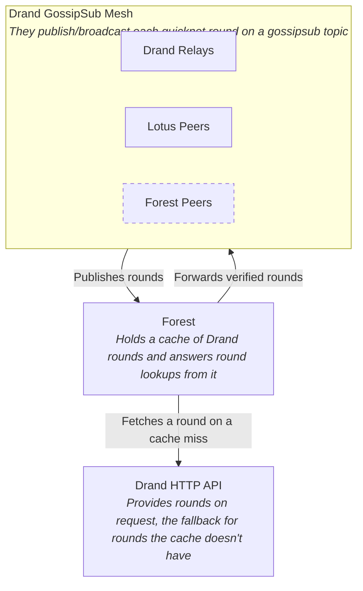
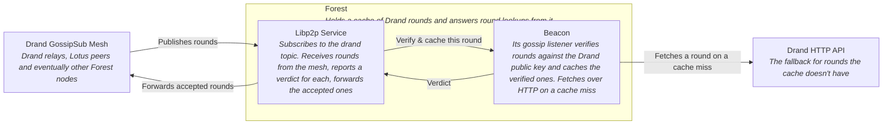
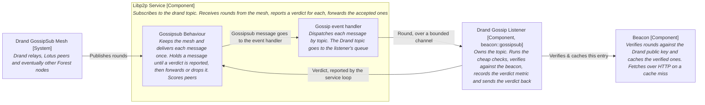
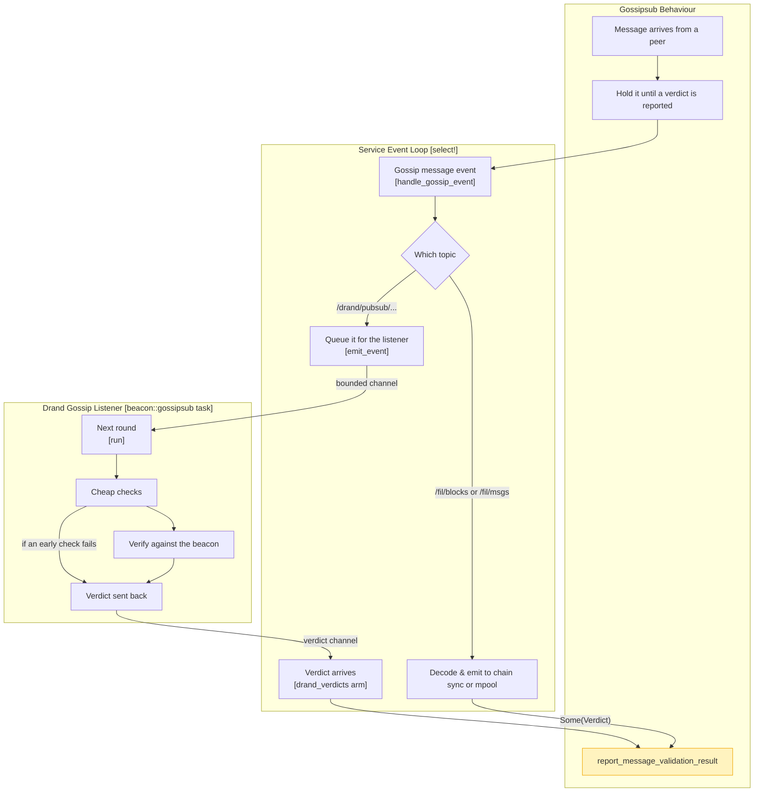

Forest listens to the `drand` relays over `gossipsub` and caches the valid rounds it receives, so block validation stops fetching them over HTTP. HTTP remains the fallback for a cache miss.

Five views, from the outside in: who Forest talks to, what runs inside it, how the network service is put together, when a verdict is decided, and what happens to one gossiped round.

## The overall view

The gossipsub mesh publishes rounds and Forest forwards the ones it verifies, so Forest is a relay to its peers as well as a consumer.

## Zoom-in on Forest

Two parts of Forest take part. The network service talks to the mesh and reports every verdict. The beacon's gossip listener verifies and caches the rounds the service hands it, and sends the verdicts back; the beacon also talks to the HTTP API. Block validation reads the same cache.

## Components of the `libp2p` service

The service touches the listener at two points: a bounded channel in, fed by the gossip handler, and a channel out, carrying the verdict. Everything `drand`-specific lives in `beacon::gossipsub`.

## When the verdict is decided

The `gossipsub` behaviour holds every message until a verdict is reported. A `drand` round is queued for the listener, which runs the cheap checks and one BLS verification on its own task and sends the verdict back; a later `select!` iteration reports it. When the queue is full the handler waits for the listener.

## Verdicts

| Verdict | Forwarded | Sender penalised | Used for                                                                        |
| ------- | --------- | ---------------- | ------------------------------------------------------------------------------- |
| Accept  | yes       | no               | a round that verifies against the chain's public key and wasn't cached yet      |
| Ignore  | no        | no               | anything an honest peer may send that we can't use: off-epoch, stale, duplicate |
| Reject  | no        | yes              | what no honest peer sends: undecodable payloads, bad or forged signatures       |

Only unchained networks (`quicknet`) are gossiped. As in Lotus there is no time window: a round only has to be newer than the last one accepted, so a slow local clock never loses a round, and a forged one is rejected by its signature.
